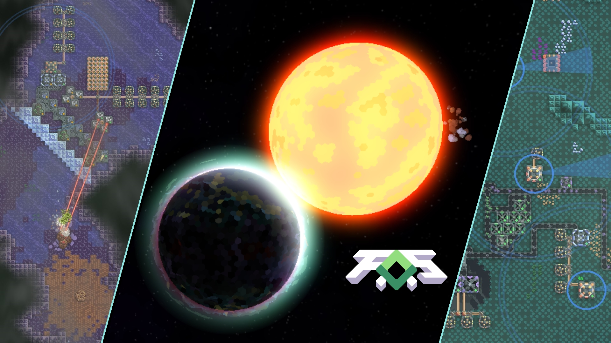

# Fictional Octo System
> [!NOTE]
> FOS is currently in Early Access - only the limited amount of content is currently available. Found a bug? [Let us know!](https://github.com/TeamOct/FOS/issues/new?template=bug_report.yml)

[](https://github.com/TeamOct/fictional-octo-system/actions)
[](https://github.com/TeamOct/fictional-octo-system/stargazers)

[](https://discord.gg/F9j8WvU4Bv)
[](https://github.com/teamoct/fos/releases/latest)



This adventure will take place in the Caldemolt Star System, planet Lumoni.

The faction Corru was almost driven to extinction at some point in the past, with only one core still standing. It has just awoken.

Survive. Expand. Locate former Corru bases and re-discover their mysteries.

Also, your core still remembers a different faction that assisted in your near demise...

> [!IMPORTANT]
> For this mod to work, you will need to install an external library to your game first: https://github.com/JojoFR1/MultiCrafter/

## How To Build
1. Use at least Java 20
2. From there you have multiple options:
   1. Option 1:
      1. Run `nmpBuildRelease` task:
      ```shell
      ./gradlew nmpBuildRelease
      ```
      2. Mod file will be in [build/libs](build%2Flibs) folder.
   2. Option 2:
      1. Create a new `settings` folder, then make a `settings.local.json` file.
      2. Inside the JSON, create the `copy` array and specify your directory(-ies) to copy the mod's JAR file to. Example directories shown here include Mindustry's working directories on Windows and Linux:
      ```json
      {
        "copy": [
          "C:\\Users\\admin\\AppData\\Roaming\\Mindustry\\mods",
          "/home/admin/.local/share/Mindustry/mods"
        ] 
      }
      ```
      3. Run `nmpCopyBuildRelease` task:
      ```shell
      ./gradlew nmpCopyBuildRelease
      ```


## Credits
- Team founder: [@Polar4ik](https://github.com/Polar4ik) (polar4ik)
- Programmers: [@Slotterleet](https://github.com/Slotterleet) (sl0tterleet), [@nekit508](https://github.com/nekit508) (nekit508), [@Durmiendo](https://github.com/durmiendo) (durmiendoo)
- Artists: [@NotTheGrawx](https://github.com/NotTheGrawx) (_motyaka), [@DoSh1K883](https://github.com/DoSh1K883) (captain_doshik), [@Krita-Burstflakes](https://github.com/Krita-Burstflakes) (krita47)
- Composer: [@SaigoN0Nozomi](https://github.com/SaigoN0Nozomi) (saigononozomi)
- Translator: [@Slotterleet](https://github.com/Slotterleet) (sl0tterleet) - Russian

## Special Thanks
- Pre-alpha Testers: [@kapzduke](https://github.com/kapzduke), [@RouterXdd](https://github.com/RouterXdd), [@Sh1penfire](https://github.com/Sh1penfire), [@DoSh1K883](https://github.com/DoSh1K883)
- Contributors: [@kapzduke](https://github.com/kapzduke), [@RouterXdd](https://github.com/RouterXdd)
- Authors of external projects we use:
  - [@liplum](https://github.com/liplum) - MultiCrafter Lib (now outdated)
  - [@JojoFR1](https://github.com/jojofr1) - MultiCrafter
  - [@GglLfr](https://github.com/ggllfr) - EntityAnno
  - [@nekit508](https://github.com/nekit508) - Mindustry mod plugin
- The Mindustry modding community.


